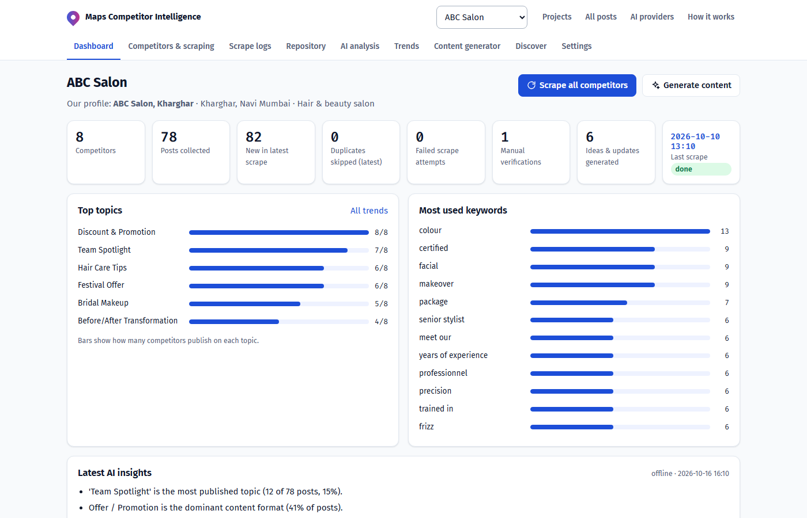
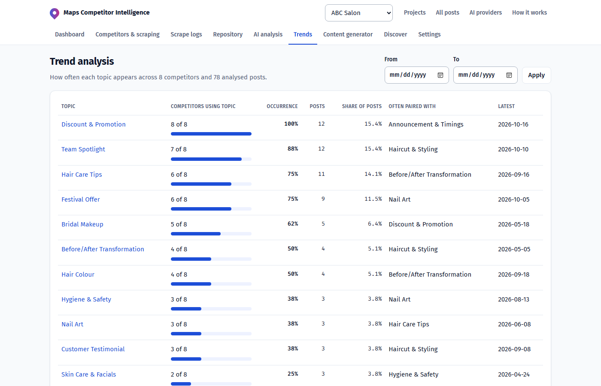
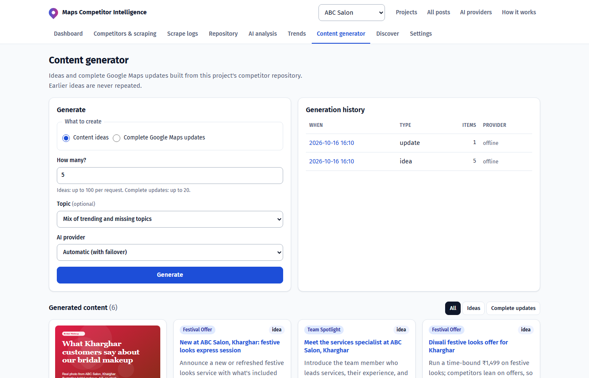

# Google Maps Competitor Update Intelligence Tool

A web app that collects competitors' **Google Maps Updates (posts)**, stores them in a de-duplicated
repository, analyses them with AI, shows topic trends, and generates new Google Maps update ideas
and complete draft updates for your own profile.

Built for the "Google Maps Competitor Update Intelligence Tool" assignment. Python (Flask + Selenium + SQLite), no login.



| Trend analysis | Content generator |
|---|---|
|  |  |

*Screenshots use the bundled demo dataset (ABC Salon, Kharghar, with 8 competitors).*

## Quick start

```bash
pip install -r requirements.txt
cp .env.example .env          # optional: add AI keys (see below)
python app.py                 # http://localhost:5000
```

On first start the database is empty, so the **demo dataset** is loaded automatically (2 projects,
13 competitors, ~140 posts with images, analysis, a scrape history and some generated ideas).

Run the tests: `python -m pytest -q tests` (browser tests run when `RUN_SELENIUM_TESTS=1` or `CHROMEDRIVER_PATH` is set).

With Docker (Chromium included):

```bash
docker build -t gmci . && docker run -p 8000:8000 -v gmci-data:/data --env-file .env gmci
```

## Using it

| Step | Where |
|---|---|
| Create a project, your own profile, keywords | Home page |
| Add / edit / remove competitors, see post counts and last scrape status | Competitors & scraping |
| Start a scrape (all or selected, optionally your own profile) and watch progress | Competitors & scraping → run page |
| Continue after a CAPTCHA | The run page banner |
| Per-run and per-competitor logs | Scrape logs |
| Search, filter (project, competitor, date, topic, keyword), images, source URLs | Repository |
| Run AI analysis, view insights, patterns, frequency | AI analysis |
| Topic trend table, monthly history chart, gap analysis | Trends |
| Generate N ideas or N complete updates, review history | Content generator |
| Find competitors from keywords | Discover |
| Provider status and connection test | AI providers |

## Architecture

```
app.py                     Flask routes + Jinja templates (templates/, static/style.css)
gmci/db.py                 SQLite schema: businesses, projects, project_competitors, keywords, posts,
                           post_media, post_analysis, scrape_runs, scrape_run_items, analysis_runs,
                           ideas, discovered_businesses
gmci/repository.py         Data access, post storage with duplicate detection, search/filter, dashboard
gmci/fingerprint.py        Business identity (place id / cid / name+address) and post fingerprints
gmci/scraper/selenium_maps.py  Live Google Maps scraper (Selenium + Chrome)
gmci/scraper/demo_source.py    Demo source with the same interface (for evaluation without Google)
gmci/jobs.py               Background scrape jobs, CAPTCHA pause/continue, discovery, scheduler
gmci/ai/providers.py       Gemini, Groq, xAI Grok, OpenRouter + offline fallback; model auto-discovery
gmci/ai/analysis.py        Post classification (LLM batches + offline analyser) and repository insights
gmci/trends.py             Topic trends, monthly history, keyword trends, own-profile gap analysis
gmci/generator.py          Idea / complete update generation with duplicate prevention
gmci/seed.py, demo_data.py Demo dataset
```

**One competitor, many projects.** A Google Maps profile is stored once in `businesses`; projects
link to it. Its posts are therefore collected and stored once, whichever project scrapes it.

**Duplicate detection.** Each post gets a fingerprint from the strongest available signal:
Google post id in the URL, else the cleaned post URL, else business identity + normalised text
(case, punctuation, emoji and URLs removed). Dates are excluded on purpose because Maps shows
relative dates ("3 weeks ago") that change between scrapes. `posts.fingerprint` is `UNIQUE`; a
re-scraped post only increments `times_seen`, and the run log counts it as a skipped duplicate.

**Scraper.** Competitors are processed one by one in a single Chrome session. For each profile it
opens the Maps URL (or searches "name + address"), handles the cookie consent page, checks for
verification, reads the header (name, category, rating, review count, address), opens the
**Updates** tab, scrolls the panel, expands "More", and extracts each update card: text, date,
images (downloaded to `data/media/`), CTA button and post link. Cards are found structurally
(a date label is the anchor, the nearest ancestor with a text block is the card, review blocks are
excluded) rather than with Google's obfuscated class names, which change often.

**CAPTCHA / verification.** Detected by the `/sorry/` URL, reCAPTCHA iframes, "unusual traffic"
text and sign-in redirects. The job pauses (never fails silently), the run and competitor are
marked `needs_verification` with a screenshot, and the run page offers Continue, Skip or Cancel.
On a desktop, run with `GMCI_HEADLESS=0` and solve it in the browser window. On a server, click
on the screenshot in the run page: clicks and typed text are sent to the headless browser, so a
person can solve the challenge remotely. The outcome is written to `scrape_run_items.manual_intervention`.
Interruptions are reduced with permitted measures only: a persistent Chrome profile
(`GMCI_CHROME_PROFILE`) so a completed verification's cookies are reused, random 4–9 s pacing
between profiles, one browser per run, and an English locale. No CAPTCHA-solving service is integrated.

**AI providers.** At least two free/developer providers are supported: Google Gemini (`GEMINI_API_KEY`),
Groq (`GROQ_API_KEY`), xAI Grok (`XAI_API_KEY`) and OpenRouter (`OPENROUTER_API_KEY`). Each
provider's model list is fetched and the best model is picked automatically (override with
`GEMINI_MODEL` etc.). Calls fail over in `AI_PROVIDER_ORDER`; the built-in offline analyser is
always last so the app keeps working without keys or when providers fail. Keys live only in
environment variables; they are never sent to the browser, logged or stored.

**Analysis.** Posts are sent in batches of 15 with the project's topic vocabulary so topics stay
consistent for trend counts. Each post gets main topic, sub-topic, keywords, content type, CTA and
offer. Repository insights cover topic and content-type mix, CTAs, offer mechanics, posts per
month and per-competitor publishing frequency, plus an AI-written list of observations.

**Trends.** For each topic: competitors using it out of the total, occurrence %, post count and
share, monthly history for the top topics, and keyword trends.

**Generation and duplicate prevention.** Requests are grounded in the repository (trends, topics
the client is missing, recurring keywords, offer mechanics and example competitor posts). Every
idea is saved with a token signature. A new candidate is rejected if its headline overlaps an
earlier one (Jaccard ≥ 0.5) or, within the same topic, its content is substantially the same
(cosine ≥ 0.62). Previous titles are also given to the model as an exclusion list, and the
generator keeps asking until the requested count is reached. Each complete update also records
how similar it is to the closest competitor post, so near-copies are flagged. Images are generated
with Gemini's image model when available, otherwise a 4:3 design card is rendered.

## Bonus features included

- Keyword discovery of competitors, matched against the repository before anything is added
- Own-profile gap analysis and recommendations
- Automatic model discovery and four AI providers with failover
- Monthly topic history chart
- Similarity scoring between generated content and competitor posts
- Scheduled re-scraping per project (Project settings → Automatic re-scrape)
- Remote CAPTCHA solving console for headless servers (a human solves it; no bypass)

## Demo data

The demo dataset uses **fictional businesses** and synthetic posts, and every record says so in
its source field. It exists so evaluation never depends on Google being reachable. Choose
**Demo source** when scraping to replay the full workflow: the next scrape of each competitor
finds one or two new posts, later scrapes find only duplicates, and "Simulate a CAPTCHA" shows the
verification pause. Choose **Live Google Maps** to scrape real profiles.

## Deployment

Any host that can run a Docker container works (Render, Railway, Fly.io, a VPS). `render.yaml` is a
ready blueprint with a persistent disk for `/data`. Set the AI keys in the host's environment
settings, not in files. Keep one web worker (the Dockerfile does) so scrape jobs and their
verification pause live in one process. Data center IPs are challenged by Google more often than
home connections; the demo dataset keeps the evaluation working when that happens.

## Configuration

See `.env.example`. Main settings: AI keys, `AI_PROVIDER_ORDER`, `GMCI_DATA_DIR`, `GMCI_HEADLESS`,
`GMCI_CHROME_PROFILE`, `CHROME_BINARY`, `CHROMEDRIVER_PATH`, `GMCI_SEED_DEMO`, `GMCI_SCHEDULER`,
`GMCI_SCHEDULE_MODE`, `SECRET_KEY`.

## Known limits

- The live scraper was tested against a local page that mimics the Maps panel structure; Google's
  real markup changes often, so check selectors with a live run before the demo video.
- Google Maps rarely exposes a direct URL for an update; when it does not, the fingerprint falls
  back to business + text.
- Re-scrapes resolve "3 weeks ago" style dates to approximate calendar dates.
